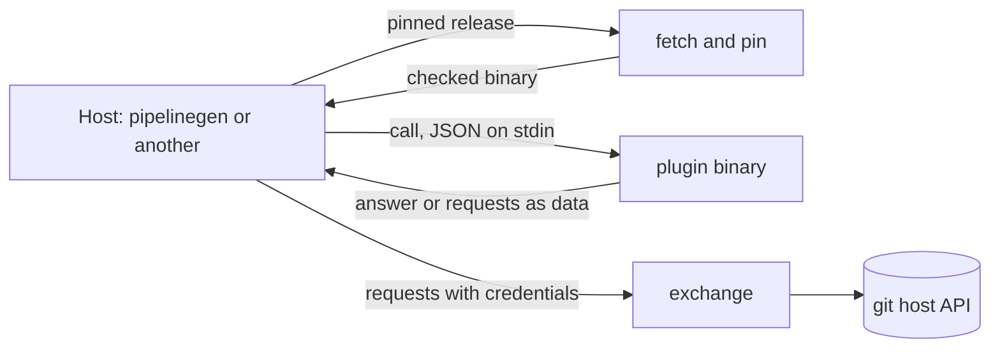

# plugkit

plugkit is the plugin plumbing that pipelinegen and other hosts share. A plugin
is an executable of its own, pinned by version and checksum. The host calls
it with a JSON request on standard input and reads a JSON answer from
standard output, or keeps one process running and talks to it in JSON lines.
A plugin that has to reach the outside answers with HTTP requests as data,
and the host sends them, adding credentials the plugin never sees.

The module depends on the Go standard library and a YAML parser.



## Packages

`plugin` is the protocol. On the plugin's side, `Main` answers one call per
process (`Serve`) or many in serve mode (`ServeLines`). On the host's side,
`Plugin.Call` runs one call per process, with an environment that holds no
token, and `Served` keeps one serve-mode process, starting it again on the
next call after it ends. Exit code 3 means the plugin can't tell, which the
host sees as `ErrCantTell`.

```go
func main() {
	os.Exit(plugin.Main(os.Args[1:], os.Stdin, os.Stdout, os.Stderr, map[string]plugin.Handler{
		"describe": func([]byte) (any, error) { return describe.Description{Name: "echo", Kind: "step", Version: "v0.1.0"}, nil },
	}))
}
```

```go
s := &plugin.Served{Plugin: plugin.Plugin{Name: "echo", Path: path}}
defer s.Close()

var d describe.Description
err := s.Call(ctx, "describe", plugin.Request{Protocol: 1}, &d)
```

`describe` is the answer to describe: name, kind, version, capabilities,
settings schema and needs, and the range of each target's versions the
plugin holds for. A capability may hold for a narrower range than the
plugin. `Of[T]` adds a kind's own keys to the same JSON object.

```go
var d describe.Description
_ = json.Unmarshal([]byte(`{"name":"lint-tools","kind":"step","version":"v0.4.0",
  "capabilities":["items",{"name":"streams","host":">=1.3"}],"host":">=1.0 <2"}`), &d)

v, _ := semver.Parse("1.2.0")
err := d.Check("host", v)                    // nil: 1.2.0 is in >=1.0 <2
streams := d.Has("streams", "host", v)     // false: it needs 1.3
```

`semver` parses versions and ranges. Comparators separated by spaces must
all hold, `||` separates alternatives, `!=` excludes, a bare version is
exact and `*` is any. A version may leave out its minor or patch (`>=1.2`,
`<2`, `1.x`). A pre-release matches only an alternative that names a
pre-release of the same major.minor.patch, as npm does. Caret, tilde and
hyphen ranges are refused.

```go
r, _ := semver.ParseRange(">=1.2 <1.4 || >=1.5 <2 !=1.6.1")
v, _ := semver.Parse("1.6.1")
r.Contains(v) // false
```

`pin` names a release: its repository (an https or ssh URL, or `owner/name`
on GitHub), an optional directory for a plugin in a monorepo, whose tags are
`<path>/vX.Y.Z`, the version, and either a sha256 per platform or the
sha256 of the release's `SHA256SUMS`.

```go
p := pin.Pin{Name: "lint", Repository: "acme/plugins", Path: "tools/lint", Version: "v0.1.0", Sums: sums}
p.Tag()         // tools/lint/v0.1.0
p.ProgramName() // lint-tools
```

`fetch` downloads a pinned release's file for a platform, checks it against
the pin and keeps it in a cache by its checksum. A file that doesn't match
is never kept, so it never runs. GitHub and GitLab releases are fetched from
their release assets. A plain git server would need the plugin built from
its tag, which fetch refuses with `ErrNotSupported` for now.

```go
f := fetch.Fetcher{Cache: cacheDir, Under: "releases"}
got, err := f.Fetch(ctx, p, pin.Platform())
// got.Path is the checked binary
```

`exchange` is the host's side of rounds. Each request a plugin asks for is
checked before any is sent: its origin must be one the host allows, its
headers ones the plugin declared and never a credential's, its token the one
purpose the call may use. Redirects never leave the request's origin, and a
host's errors and rate limits are retried.

```go
x := exchange.Exchange{
	Name: "github", Noun: "connector", Plugin: p, Request: plugin.Request{Protocol: 1},
	Purposes: map[string]string{"status": "report"}, Auth: &exchange.Auth{Header: "Authorization", Scheme: "Bearer"},
	Hosts: hosts, Tokens: map[string]string{"report": token},
}
err := x.Call(ctx, "status", workDir, args, &answer)
```

`container` runs a command in an image with docker or podman, the given
directories mounted and the given environment only. A rootful tool's files
are handed back to the user by a second container that runs chown. A call can run sandboxed: `Network: "none"` cuts the container off, `ReadOnlyRoot` makes the image read-only, mounts marked `ReadOnly` can't be written, and `Env` is the whole environment besides the image's own.

```go
tool, _ := container.Find("")
r := container.Run{Tool: tool, Image: "busybox:1.37.0", Name: container.Name("build"), Dir: dir,
	Mounts: []container.Mount{{Host: dir, At: dir}}, Cmd: []string{"make", "test"}}
cmd, _ := r.Command(ctx)
err := cmd.Run()
```

A plugin can also come without a release. `manifest` reads the
`manifest.yaml` in its directory: name, kind, program, the build's image
(pinned by digest), command and environment, its platforms (`os/arch`
pairs, or `[any]` for one build that runs everywhere), and the files and
asset directories that go with the program. Unknown keys are refused.
`build` runs the command in that image through `container`, once per
platform, with the repository mounted read-only, `{out}` the only place it
can write, no network unless the manifest asks for one, and `GOFLAGS=-trimpath`.
It lays the plugin out as its zip holds it. `build.run` is an argv, or a list of them run in order, each in a container
of its own with no shell around it; the first that fails ends the build.
`build.copy: true` runs them in a writable copy of the repository, for a
build that writes beside its sources, as `npm ci` does. The copy holds the
files git tracks and nothing else: of a checkout, those its index lists, so
untracked and ignored files (Bazel's links, `node_modules`, earlier
outputs) never reach the build; of a pinned commit, its tree. A tracked
symlink is refused, and so is a directory that is no git checkout. The commands and their environment
may also name `{commit}`, the full commit built, and `{version}`, the
version of the tag the build came through (`repository.At`, or a
`store.Pin` naming its version) without its `v`, or `0.0.0-dev+<the
commit's first 12 characters>` when it came through none, a version Go and
npm both take, to stamp the program as a release is stamped. A build with a version is kept
apart from one of the same commit without. A host that runs the commands
itself, in sandboxes of its own, hands `build.Layout` the directory each
platform's build wrote `{out}` into, and gets the layout `Build` would have
made from them. `bundle` packs that layout into
a zip with fixed times and sorted entries, so the same build gives the same
bytes, and unpacks one safely. `manifest.yaml` must sit at the zip's top
level. A zip is refused if it has a path that leaves the directory, a
symlink, a file that is no part of the plugin, or an executable besides the
program, or if it unpacks past a size limit.

`store` resolves a plugin pinned by a commit or by a zip to a directory of
the cache. A commit is fetched into a bare mirror, built for the platform
and kept under a key of its repository, commit, path, manifest digest,
platform and image digest. A zip is downloaded, checked against its sha256
before it is opened, unpacked and kept under that sha256. The same key
never builds or downloads twice, and every entry appears whole, by a rename:
two resolves at once, in one process or several, each work in a directory
of their own, the first rename wins and the other takes its entry. Each
fetches a commit into a repository of its own, so no git repository is
written by two at once. A server that serves no commit by its id gets the
pin's `Ref` fetched instead, never every branch and tag.
`store.Trim` removes what no resolve used lately.

```go
s := store.Store{Dir: filepath.Join(cacheDir, "releases")}
r, err := s.Resolve(ctx, store.Pin{Zip: &store.Zip{URL: url, SHA256: sum}}, "linux/amd64")
// r.Program is the checked program for linux/amd64, r.Dir holds manifest.yaml and the assets
```

A plugin manifest may also carry what a listing shows, `description` and
`logo` (a file of the plugin's directory, or an `https://` URL), and what the plugin offers and
needs, `implements` and `requires`, each a list of `"<name> <semver range>"`.
`logo` is one image for both color schemes, or one for each:
`logo: {light: logo.svg, dark: logo-dark.svg}`, either alone standing in
for both. A repository manifest's entry takes `logo` in the same two forms.
A plugin of kind `meta` is schemas alone: no `build` and no `program`, and
`schemas`, a JSON Schema file for each message and one for its answer, with
an optional `ack_timeout`, the Go duration a receiver has to ack or nack a
message. It resolves to its directory as a plugin built for `[any]` does,
and nothing of it is built.

A manifest may `include` files and directories of the plugin's directory,
`include: [service.yaml, conf/]`. They are copied as they are into the
resolved plugin, under their paths relative to the plugin's directory, and
packed at those paths in its zip beside `manifest.yaml`. Each path is
relative, without `..` or `.`, and none may be another's, lie within one, or
meet a path the plugin holds otherwise (its `files`, `assets`, `logo`,
schemas or program). The files come from what git tracks: a pinned commit's
tree, or of a checkout the files its index lists, each as the checkout
holds it, so untracked and ignored files never get in. A symlink anywhere
on a path, an executable file, and an included path with no tracked file
are refused, each by its path. A plugin with no program may include paths
with no `build` at all: nothing runs and no image is pulled, so it resolves
without docker or podman. Beside a build, the build runs first and the
included paths are copied after it. A plugin with no program, no assets and
no included path delivers nothing and is refused; a `meta` plugin still
needs neither. A zip whose manifest includes a path it holds no file of is
refused. The cache keeps an included plugin of a commit under the commit,
like any build.

A manifest's optional `spec` is a mapping for the host: plugkit carries it
and never looks into it. `Manifest.Spec` holds it as JSON with its keys
sorted, so a host reads one form; `repository.List` gives each plugin the
default branch's (`Plugin.Spec`), `At` the version's, and the zip and the
store keep it with the manifest's bytes. A spec that is no mapping, that
JSON can't say (an anchor or alias, a merge key, a key that is no string or
is there twice, a tag of its own, an infinite or NaN number), or that is
over 64 KiB as JSON is refused.

A manifest's optional `runtime` says what runs the program besides the
machine, with an optional semver range: `node` or `"node >=22 <27"` for a
`.mjs` program. Without one the program is a native binary, so a host
without the runtime can refuse the plugin before it fetches it. As a
mapping, `runtime` takes that string as `program`, and may add the `image`
a host runs the program in, pinned by digest as `build.image` is, and
`native: true`, for a program that needs nothing of its host, so a host
that trusts the plugin may run it directly as a process. Only a plugin
with a `program` has a runtime.

```yaml
runtime:
  image: docker.io/library/alpine@sha256:<64 hex>
  native: true
```

A manifest of any kind may list its `permissions`, what the plugin lets
people do: each a `name` (`area:action`, lower-case letters and dashes,
unique), a `description`, and the least role that holds it by `default`,
one of `display`, `viewer`, `operator`, `maintainer` and `admin`. A host
grants and checks them; the manifest only declares them.

`repository` reads what a plugin repository holds, from
`repository-manifest.yaml` at its root (or a root `manifest.yaml` with a
`plugins` list), and lists its plugins' versions with plain git: `git
ls-remote --tags` for the versions, one shallow fetch of the default branch
for the manifests, and the caller's git credentials. No forge's API is used.
A repository with neither file at its root but a plugin's `manifest.yaml`
is that one plugin, at `.`, tagged `v{version}`. A plugin whose manifest
doesn't read is listed with its `Err`, and the others as they are; only a
repository manifest that doesn't read fails the listing. Each version
names its tag and commit, and a plugin its logo's bytes when it is an SVG,
PNG, JPEG or WebP image of at most 256 KiB, by its content. `At` reads a
version's manifest at the commit its tag names, and refuses a tag that
names another commit when read again after the fetch, or another than
`Options.Commit`.

A logo given as a URL is fetched by `List` and `AtRelease` (`At` with the
version's logo), so a host gets `LogoData` and `LogoType`, and for a dark
color scheme `DarkLogoData` and `DarkLogoType`, and fetches nothing itself. Manifests are untrusted, so the fetch is https alone, with
no credential, cookie, proxy or redirect, within 10 seconds and 256 KiB,
and its dialer refuses every loopback, private, link-local (169.254.169.254
among them), CGNAT, unspecified, multicast and reserved address, checked
at connect time on the address the name resolved to, so a name that
resolves elsewhere the second time gets no further. `Options.LogoCache`, a
directory, keeps each fetched logo by its URL and the plugin's version;
without one, every listing fetches again. A logo that fails to fetch, or is
no SVG, PNG, JPEG or WebP image, sets `LogoErr` and never fails the plugin.
An SVG logo, from a file or a URL, is the plugin author's markup: a host
sanitizes it before rendering it.

```yaml
repository: 1                   # the format; another is refused
tags: "{path}/v{version}"       # {name}, {path} and {version}; default {name}-v{version}
plugins:
  - manifest: step/go-test/manifest.yaml   # its directory is the plugin's path
    name: go-test                          # name, kind, description and logo default to the manifest's
```

```go
plugins, err := repository.List(ctx, "https://git.example.com/acme/plugins", repository.Options{})
m, commit, err := repository.At(ctx, "https://git.example.com/acme/plugins", "step/go-test", "0.2.0", repository.Options{})
```

A server that runs `List` or `At` on URLs its users give sets
`Options.Untrusted`, and `store.Store.Untrusted` for pins they give. Then
only `https://`, `ssh://` and `user@host:path` remotes are fetched; an
option, a transport helper (`ext::` or any `::`), `file://` and a local
path are refused, and the URL always follows `--`. git gets none of the
host's config, credential helpers, `url.insteadOf` or ssh keys
(`GIT_CONFIG_GLOBAL=/dev/null`, no system config, ssh with no identity,
agent, config file or known hosts, https and ssh only, no redirect
followed), and the caller's `Credential`, a token handed to a one-shot
helper through the environment, never in the URL or an argument, is the
only credential; git gets it only for https on the credential's host. An
ssh remote's host key must be in the caller's `KnownHosts`: without them,
every ssh remote fails. `List` and `At`
then also stop after `Timeout` and once their fetches write more than
`MaxBytes`, and so does the store's fetch of an untrusted pin.
`AllowLocal` lets an untrusted URL be `file://` or a local path, for tests
alone. Unset, git runs with the host's credentials, as a CI job needs.

`kit` is the generic part of a conformance kit: it calls a plugin in work
directories of its own and holds the checks every kind shares. It fails a
plugin that answers an unknown call, whose describe names another version
than its release, or whose answers carry a credential.

```go
h := &kit.Harness{Plugin: p, Work: workDir, Canary: "kit-canary"}
h.Refuses(ctx, func() any { return plugin.Request{Work: h.WorkDir()} }, "no-such-call")
h.CheckVersion(described.Version, "v0.4.0")
failed, err := kit.Print(os.Stdout, h.Results())
```

`redact` keeps secret values out of what a host prints: values it is given,
and the environment's variables whose names say they hold one.

`tpl` expands a configuration file written as a Go template before it is
read as YAML. Its inputs are `.Values`, `.Defines` and the environment
variables the file allows in `.Env`. The file's own `values:`, `defines:`
and `env:` are the defaults, under values files and command-line flags.
`include` reads a `define`, a file of the repository, or a remote file
pinned to a full commit. A missing key is an error. The result records
every input and include it read, and `Digest` changes when any of them does.

```go
values, defines, err := tpl.ReadValuesFile("ci/values/staging.yaml", data)
set, err := tpl.ParseSet(tpl.Set, "replicas=3")
res, err := tpl.Expand(ctx, "ci.yaml", src, tpl.Inputs{
	Values:  tpl.Merge(values, set),
	Defines: defines,
}, tpl.FSResolver{FS: os.DirFS(repo), Commit: head})
fmt.Println(string(res.Text), res.Read.Digest())
```

## Working on it

Install the commit-msg hook once per clone with
`cp ci/commit-msg "$(git rev-parse --git-path hooks)/commit-msg"`. Lint with
`golangci-lint run ./...` and test with `go test ./...` before each commit.

## License

plugkit is licensed under the [Apache License, Version 2.0](LICENSE), so
the plugins and tools built with it may carry any license. Every folder of
it is under that license.
