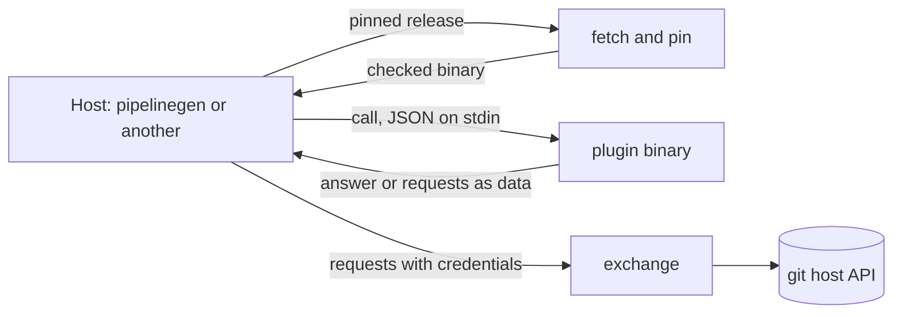

# plugkit

<p align="center">
  A Go library for building, packing and serving plugins: programs a host
  calls with JSON, pinned by version and checksum.
</p>

<p align="center">
  <a href="LICENSE"></a>
</p>

plugkit is the plugin plumbing that pipelinegen and other hosts share. A
plugin is an executable of its own. The host calls it with a JSON request
on stdin and reads a JSON answer from stdout, or keeps one process running
and talks to it in JSON lines. plugkit holds both sides of that, and
everything around it: pinning, fetching, building, packing and listing
plugins.

## Why plugkit

- **Plugins are plain programs.** Any language that reads stdin and writes
  stdout can be a plugin. A Go plugin is a `main` with a map of handlers.
- **Nothing unchecked runs.** A release's file is checked against its pin
  before it is kept, and a file that doesn't match is never kept.
- **Plugins hold no credentials.** A plugin that has to reach the outside
  answers with HTTP requests as data. The host checks each one and sends
  it with a token the plugin never sees.
- **Sealed builds, stable zips.** A plugin builds in an image pinned by
  digest, with no network unless its manifest asks for one. Its zip has
  fixed times and sorted entries, so the same build gives the same bytes.
- **Safe with URLs your users type.** In untrusted mode, git fetches only
  https and ssh remotes, with none of the host's config, credential
  helpers or ssh keys.
- **Few dependencies.** The module needs the Go standard library and a
  YAML parser.

## How it works



Every plugin answers `describe` with its name, kind and version, what it
can do, the settings it reads and the host versions it holds for.

## Quick start

You need Go 1.27. Make a plugin that answers `describe`:

```sh
mkdir echo && cd echo
go mod init example.com/echo
go get github.com/sideways-works/plugkit@latest
```

```go
// main.go
package main

import (
	"os"

	"github.com/sideways-works/plugkit/describe"
	"github.com/sideways-works/plugkit/plugin"
)

func main() {
	os.Exit(plugin.Main(os.Args[1:], os.Stdin, os.Stdout, os.Stderr, map[string]plugin.Handler{
		"describe": func([]byte) (any, error) {
			return describe.Description{Name: "echo", Kind: "step", Version: "v0.1.0"}, nil
		},
	}))
}
```

```console
$ go build -o echo . && echo '{"protocol": 1}' | ./echo describe
{"kind":"step","name":"echo","version":"v0.1.0"}
```

A host calls it with `plugin.Plugin`, one process per call, in an
environment that holds no token of the host's:

```go
// host/main.go
package main

import (
	"context"
	"fmt"
	"os"

	"github.com/sideways-works/plugkit/describe"
	"github.com/sideways-works/plugkit/plugin"
)

func main() {
	p := plugin.Plugin{Name: "echo", Path: os.Args[1]}

	var d describe.Description
	if err := p.Call(context.Background(), "describe", plugin.Request{Protocol: 1}, &d); err != nil {
		fmt.Fprintln(os.Stderr, err)
		os.Exit(1)
	}

	fmt.Println(d.Name, d.Kind, d.Version)
}
```

```console
$ go run ./host ./echo
echo step v0.1.0
```

`plugin.Served` keeps one process running instead and talks to it in JSON
lines.

## Documentation

[docs/packages.md](docs/packages.md) walks through every package with an
example. Each package's Go documentation has every type and function.

| Package | What it does |
|---|---|
| [`plugin`](docs/packages.md#plugin) | the protocol: a plugin's side (`Main`, `Serve`, `ServeLines`) and the host's (`Plugin`, `Served`) |
| [`describe`](docs/packages.md#describe) | the answer to describe, and checks of a plugin's ranges against a host's version |
| [`semver`](docs/packages.md#semver) | versions and the ranges a plugin and its host declare |
| [`pin`](docs/packages.md#pin) | a release and how its files are checked |
| [`fetch`](docs/packages.md#fetch) | downloads a pinned release's file and checks it |
| [`exchange`](docs/packages.md#exchange) | the host's side of rounds: a plugin's HTTP requests, checked and sent with a token |
| [`container`](docs/packages.md#container) | runs a command in an image with docker or podman |
| [`manifest`, `build`, `bundle`](docs/packages.md#manifest-build-and-bundle) | a plugin's `manifest.yaml`, its build in a container, and its zip ([more keys](docs/packages.md#more-of-the-manifest)) |
| [`store`](docs/packages.md#store) | resolves a plugin pinned by commit or zip to a directory of the cache |
| [`repository`](docs/packages.md#repository) | lists a plugin repository's plugins and versions with plain git |
| [`gitsafe`](gitsafe) | runs git against a remote an untrusted caller names |
| [`kit`](docs/packages.md#kit) | the generic part of a conformance kit |
| [`redact`](docs/packages.md#redact) | keeps secret values out of what a host prints |
| [`tpl`](docs/packages.md#tpl) | expands Go templates in CI config files before they are read as YAML |

## Building and contributing

| Command | What it does |
|---|---|
| `cp ci/commit-msg "$(git rev-parse --git-path hooks)/commit-msg"` | once per clone: checks each commit message |
| `golangci-lint run ./...` | the lint, with the repository's `.golangci.yml` |
| `go test ./...` | every test |

`.tool-versions` names the Go and golangci-lint versions. Lint and test
before each commit. Commits are one conventional subject line of at most
72 characters, with no body.

## License

plugkit is licensed under the [Apache License, Version 2.0](LICENSE), so
the plugins and tools built with it may carry any license. Every folder of
it is under that license.
